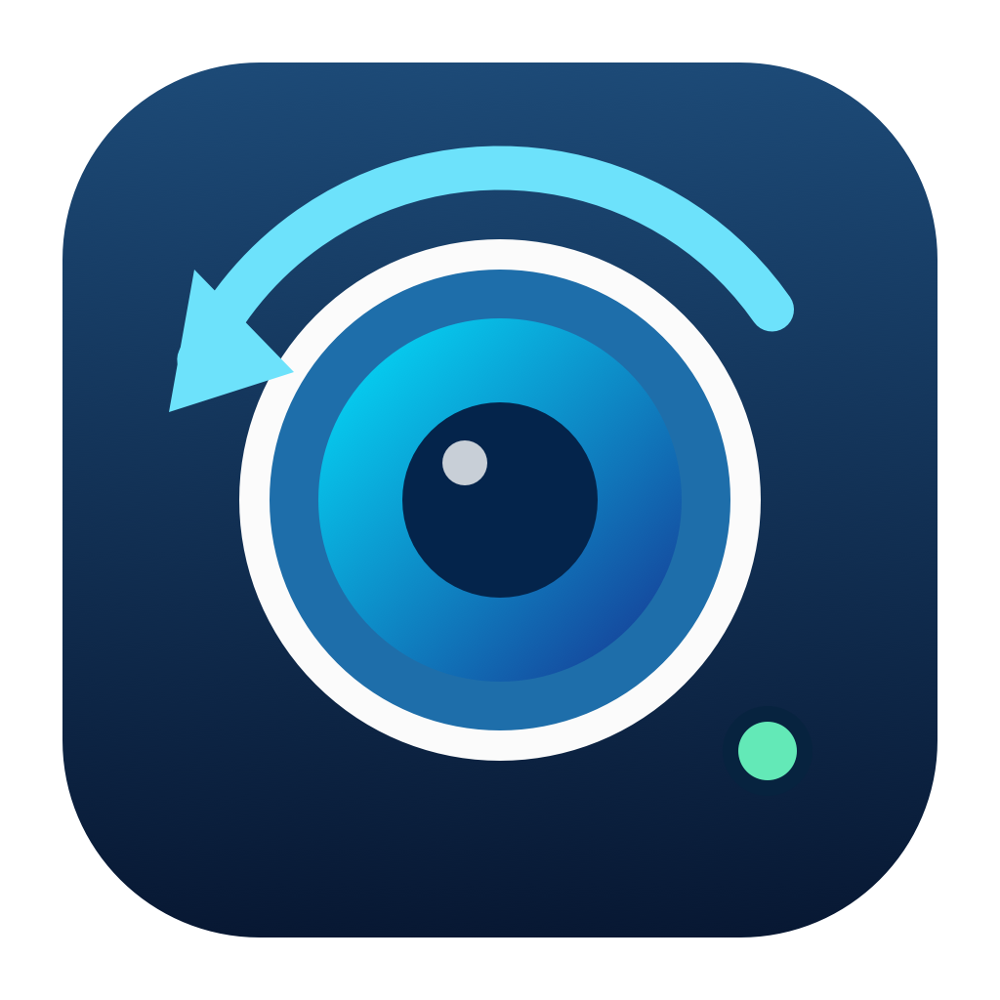

# Reversed engineering Icsee



**A native macOS viewer for iCSee / Xiongmai cameras over your own network.**

[Português brasileiro](README.pt-BR.md) · [How it was reverse engineered](docs/REVERSE_ENGINEERING.md) · [Contributing](CONTRIBUTING.md)

[](https://github.com/ndelanhese/reversed-engineering-icsee/actions/workflows/ci.yml)
[](LICENSE)

Reversed engineering Icsee started with a simple need: view personally owned iCSee cameras on a Mac, with native windows and direct local video. Research on an Android app exported from the owner's phone helped identify the SDK family; authenticated camera tests established the RTSP behavior needed by this independent Swift implementation.

It is a small, unofficial interoperability project. It does not embed the Android app or its SDK, and it is not affiliated with iCSee or Xiongmai. Compatibility depends on your camera's firmware and local RTSP support.

## What works

- Multiple cameras in a grid, with editable addresses, ports, channels and main/substream selection.
- Rename a camera without interrupting its video.
- Cinema mode, resizable floating popups, and native macOS fullscreen.
- One shared stream per camera across its views.
- Menu bar icon with hover preview and a saved default camera.
- Local camera authentication, optional macOS Keychain storage, and one compatibility retry for Sofia-style authentication.
- Connection diagnostics and a watchdog that stops showing frozen video as live.
- Native PTZ nudges, Stop, device presets and image controls based on camera-provided profiles/options.
- Discovered local vendor settings with structured editing, conflict checks and verified readback.
- Local SD-card calendar/history, native recorded-video playback, seeking/speed and original/movie/interval export. See the [recordings guide](docs/RECORDINGS.md).

The interface follows your macOS preferred app language: **English or Brazilian Portuguese**, with English as the development-language fallback when no preferred supported language matches. macOS per-app language preferences are respected. Quit and reopen the app after changing its language in **System Settings → General → Language & Region → Applications**. User-entered camera names are preserved.

Live video output is scaled to 1280 pixels wide and capped at 15 fps. Recorded video uses a separate native player at its stored resolution/cadence. Live/two-way audio, Mac-side live recording, cloud-account login and vendor P2P are not implemented. Camera-side recording/audio settings can be available through device controls. Remote viewing requires an already configured VPN into your home network; Reversed engineering Icsee does not configure one.

## Download and install

**[Download the latest macOS release](https://github.com/ndelanhese/reversed-engineering-icsee/releases/latest)** — Apple Silicon, macOS 14 or later.

1. Download the **macos-arm64.dmg** asset from the release page, open it, and drag **Reversed engineering Icsee** to **Applications**. A ZIP is also available.
2. Open the app from Applications. FFmpeg is included: no Homebrew, Python or compiler is needed to run this release.
3. Builds are **ad-hoc signed, not Developer ID signed or notarized**. If macOS blocks the first launch and you trust this download, follow [Apple's instructions](https://support.apple.com/en-us/102445): **System Settings → Privacy & Security → Open Anyway** after the blocked attempt. There is no installer script that disables Gatekeeper.

Release assets include `SHA256SUMS.txt`, FFmpeg build metadata and its corresponding source archive. The app uses [FFmpeg](https://ffmpeg.org/) under LGPL-2.1-or-later as a separate executable; [download its source alongside the app](https://github.com/ndelanhese/reversed-engineering-icsee/releases/latest/download/ffmpeg-9.0.2.tar.xz). App source and original icon are MIT licensed.

Intel builds and every supported macOS version have not been validated. There is no automatic updater.

## Build from source

Requirements: **Apple Silicon, macOS 14+, Swift 6 toolchain, Python 3.12+, and FFmpeg**. For a quick development build, install Apple's Command Line Tools if needed and FFmpeg using an existing Homebrew installation:

```sh
xcode-select --install
brew install ffmpeg
git clone https://github.com/ndelanhese/reversed-engineering-icsee.git
cd reversed-engineering-icsee
python3 build.py
open "dist/Reversed engineering Icsee.app"
```

The build uses `swiftc` directly. There is no Xcode project, Swift package dependency, Java runtime, Go runtime, or Rust runtime in the app. The quick development build uses an external FFmpeg from `/opt/homebrew/bin/ffmpeg` or `/usr/local/bin/ffmpeg`. Binary releases bundle a standalone LGPL decoder and prefer it over the external installations.

For the same self-contained app and packages distributed in Releases:

```sh
python3 Tools/build_ffmpeg.py
python3 build.py --bundle-ffmpeg
python3 Tools/package_release.py
```

Packages land in `dist/release/`. See [release maintenance](docs/RELEASING.md) for checks, licensing, tags and automation.

## Add your cameras

1. Open **Add camera**. New installations start empty.
2. Enter the camera's local IP/hostname, RTSP port (usually `554`) and channel (usually `1`). Find the address in your router's connected-device list or the camera's network settings.
3. Click **Connect**, then enter the camera's **local device** username and password. These can differ from your iCSee cloud credentials.
4. Enable **Save in macOS Keychain** only if you want to remember credentials.
5. Try **Substream** if the main stream is too heavy or unsupported.

### Saved credentials and Keychain

Saved passwords remain in macOS Keychain; they are not written to preferences, logs or repository files.
The system prompt asks for your **Mac login/Keychain password**, not your camera password.
Denied or cancelled Keychain access is reported separately and does not erase existing credentials.

Public builds currently use ad-hoc signing. A new build has a different signing identity, so
**Always Allow may need to be granted again after an update**. A normal relaunch of the same
trusted build should retain access. Keep the login Keychain unlocked under your normal macOS policy.

For stable identity across local builds and downloaded updates, run once from a trusted source checkout:

```sh
python3 Tools/local_sign.py --create "/path/to/Reversed engineering Icsee.app"
```

This generates a self-signed code-signing identity on your Mac. Its private key is imported
non-extractable into the default Keychain, using in-memory pipes, with signing access for
`/usr/bin/codesign`. No root certificate trust settings are changed. This is **not** Developer ID
signing or notarization. The identity is local to that Keychain and is not uploaded to GitHub.
Existing camera items may require one final **Always Allow** authorization after this change.

`build.py` automatically reuses that identity when available. After replacing the app with a new
public download, run `python3 Tools/local_sign.py "/path/to/Reversed engineering Icsee.app"`
**before opening it** to reuse the same identity. Release packaging explicitly stays ad-hoc;
it does not distribute your local signing identity. Do not delete/recreate the identity on every build.
An expired or lost identity requires a new authorization. `--sign-identity FINGERPRINT` selects
another signing certificate, and `--sign-identity -` explicitly creates an ad-hoc build.

Do not forward camera ports to the public internet. Local RTSP is not an encrypted transport; use a trusted LAN or VPN.

| Action | Control |
| --- | --- |
| Cinema mode | Double-click video or click the expand button |
| Leave cinema | `Esc` or **Back** |
| Floating window | Camera menu **⋯ → Floating window** |
| Camera fullscreen | Camera menu **⋯ → Full screen** |
| Exit fullscreen | `Esc` |
| Toggle focused window fullscreen | `Control + Command + F` |
| Rename / edit connection | Camera menu **⋯** |
| SD-card history / playback / export | Camera menu **⋯ → Recordings…** |
| Close popup | Native close button or `Command + W` |

Closing a popup keeps the shared stream alive. Closing the main window keeps the app and active cameras running in the menu bar. Use `Command + Q` to stop all streams and exit.

## Menu bar preview

Hover over the lens icon in the macOS menu bar to see the selected camera. The panel contains only the camera selector and video; leaving both the icon and panel dismisses the hover preview. Click the icon to keep the panel open, then click again or click outside to dismiss it.

Choose **Preview camera** in the panel, or **⋯ → Use for menu bar preview** on a camera card. This default is saved between launches. Renaming preserves the choice; deleting the selected camera falls back to another saved camera.

The preview shares the existing video connection with the grid and floating windows. Click the app’s Dock icon to reopen the main window. Connect cameras and open controls, recordings or enlarged views from the main app. Hovering never prompts for credentials or automatically starts a connection.

## Camera controls

Open **⋯ → Camera controls…** on a camera, or use the controls button in cinema/floating views. Active video credentials are reused in memory; otherwise use **Authenticate…**. The window provides supported PTZ/preset controls, image options and discovered local device settings. Changes are explicit and verified; unsupported or forbidden operations remain visible.

See the [camera control guide](docs/CAMERA_CONTROLS.md) for profiles, ports, movement limits, advanced fields, restart behavior and validation scope. Cloud/phone features remain separate.

## Privacy and authentication

Camera names, addresses and settings live in local macOS preferences. Credentials are saved in Keychain only when requested. The app sends authenticated URLs to FFmpeg through an in-memory pipe rather than process arguments or a playlist file. Raw decoder diagnostics are classified in memory instead of being saved or displayed. The app has no telemetry or cloud-account integration.

Passwords, derived Sofia credentials and decoded video still exist in process memory while viewing. The Sofia transformation exists for legacy protocol compatibility; it is not modern password storage or encryption. See [security policy and boundaries](SECURITY.md).

## Development and validation

```sh
python3 test.py --core-only  # deterministic protocol/parser checks; no camera needed
python3 test.py              # adds native window lifecycle checks; desktop required
python3 test.py --interactive # adds menu bar, scene reopening and fullscreen checks
python3 build.py             # creates and verifies a signed arm64 .app
```

CI builds the app, checks core behavior and native bundle language selection, compiles the pinned FFmpeg, and verifies DMG/ZIP packages on a GitHub-hosted macOS runner. Offline synthetic H.264/HEVC decoding checks the bundled executable without Homebrew. Rendered localization and window/fullscreen checks remain desktop checks; CI is not a real-camera compatibility test. No camera credentials or APKs are required. The first packaging build downloads FFmpeg source from its official site.

Start with [architecture](docs/ARCHITECTURE.md), [research provenance](docs/REVERSE_ENGINEERING.md), and [contribution rules](CONTRIBUTING.md). Please use synthetic data in issues and pull requests.

## Research credits

Built with assistance from Codex. The investigation used [REA](https://rea.tools/) and its [`reverse-engineer-anything` skill](https://github.com/morluto/rea/blob/main/.agents/skills/reverse-engineer-anything/SKILL.md), including package inspection and a JADX bridge. Development also used Swift/macOS guidance, systematic debugging, test-driven checks, review and verification skills. [The research notes](docs/REVERSE_ENGINEERING.md) explain their actual roles, the evidence behind compatibility decisions, and what remains unverified.

## License

Reversed engineering Icsee's original source, icon and documentation are [MIT licensed](LICENSE). Binary releases include FFmpeg under LGPL-2.1-or-later, its notices in the app and matching source as a release asset. Android packages, decompiled vendor source, vendor libraries and camera footage are not included. See [third-party notices](THIRD_PARTY_NOTICES.md).
