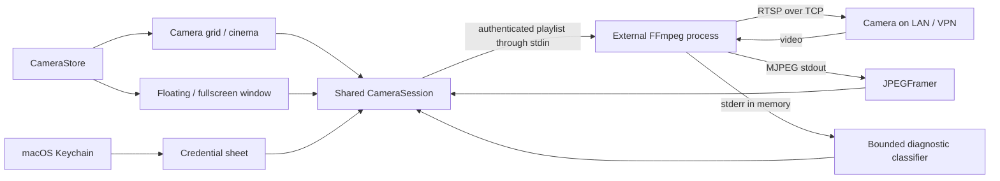

# Architecture

Reversed engineering Icsee is a Swift 6 app using SwiftUI for views and AppKit for native windows. It builds directly with `swiftc`; no package resolver or Xcode project is needed.

## Source map

| File | Responsibility |
| --- | --- |
| `Sources/CameraCore/CameraCore.swift` | Endpoint validation and encoding, RTSP playlist generation, Sofia transformation, JPEG framing, diagnostic classification and liveness rules |
| `Sources/ReversedEngineeringIcsee/CameraSession.swift` | FFmpeg process lifetime, pipes, background parsing, main-actor frame publication, watchdog and one compatibility retry |
| `Sources/ReversedEngineeringIcsee/CameraStore.swift` | Camera models, local preferences and Keychain operations |
| `Sources/ReversedEngineeringIcsee/ReversedEngineeringIcseeApp.swift` | Main scene, camera grid, cinema selection, camera controls and application termination |
| `Sources/ReversedEngineeringIcsee/CameraWindows.swift` | One detached native window per camera, floating/fullscreen lifecycle and shared sessions |
| `Sources/ReversedEngineeringIcsee/CameraVideo.swift` | Aspect-preserving display and shared viewer controls |
| `Sources/ReversedEngineeringIcsee/CameraForms.swift` | Local authentication, renaming and connection settings |

## Lifecycle

`CameraStore` owns one session per saved camera. Grid, cinema and popup observe the same session. Changing a name preserves it; changing an endpoint stops the old stream. Closing a popup releases that view only. Removing a camera stops its session and removes its saved credentials. Application termination closes auxiliary windows and stops all sessions.

Each stream has a generation identifier so completion or frames from an old decoder cannot update a replacement connection. Initial connection times out after 20 seconds without a frame; an established stream times out after 12 seconds without a new frame. A 401 before any frame triggers at most one retry using a Sofia-derived query credential. Errors after successful video do not silently enter a retry loop.

FFmpeg decodes the selected video stream, drops audio, scales output to a width of 1280 pixels and caps output at 15 fps. Frames cross stdout as MJPEG; Swift displays decoded `NSImage` instances. This favors a simple implementation over native compressed-stream playback efficiency. Multiple cameras can use substantial CPU.

## Build and test decisions

`build.py` compiles arm64 for a macOS 14 minimum and verifies the app's ad-hoc signature. The app bundle and display name are `Reversed engineering Icsee`; its executable is `ReversedEngineeringIcsee`. The legacy bundle identifier `local.CamMac` and Keychain service `local.CamMac.camera` intentionally stay stable to preserve preferences and saved credentials across the rename.

Direct `swiftc` builds avoided an incompatible Swift Package Manager `PackageDescription` module in the original local toolchain. `ViewState` explicitly names `SwiftUI.State` to avoid an SDK macro name collision in that environment. Neither workaround is a runtime dependency.

`test.py --core-only` runs deterministic parser/protocol checks without a graphical session. Default tests additionally check native popup ownership, reuse, reopening, empty first launch and saved-profile restoration. `--interactive` also tests native fullscreen and Escape; it needs an active desktop. None of these tests opens a real camera connection.
