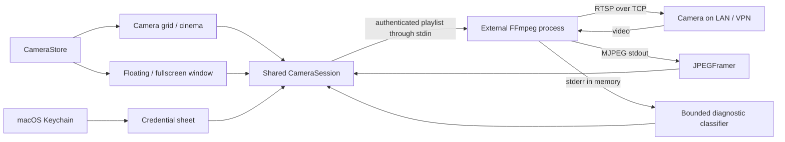

# Architecture

Reversed engineering Icsee is a Swift 6 app using SwiftUI for views and AppKit for native windows. It builds directly with `swiftc`; no package resolver or Xcode project is needed.

## Source map

| File | Responsibility |
| --- | --- |
| `Sources/CameraCore/CameraCore.swift` | Endpoint validation and encoding, RTSP playlist generation, Sofia transformation, JPEG framing, diagnostic classification and liveness rules |
| `Sources/ReversedEngineeringIcsee/CameraSession.swift` | FFmpeg process lifetime, pipes, background parsing, main-actor frame publication, watchdog and one compatibility retry |
| `Sources/ReversedEngineeringIcsee/CameraStore.swift` | Camera models, local preferences and Keychain operations |
| `Sources/ReversedEngineeringIcsee/ReversedEngineeringIcseeApp.swift` | Main scene and native menu commands |
| `Sources/ReversedEngineeringIcsee/CameraBoard.swift` | Camera grid, cinema selection and camera controls |
| `Sources/ReversedEngineeringIcsee/CameraMenuBar.swift` | Native status item, hover/pinned preview, main-window routing and background app lifecycle |
| `Sources/ReversedEngineeringIcsee/CameraWindows.swift` | One detached native window per camera, floating/fullscreen lifecycle and shared sessions |
| `Sources/ReversedEngineeringIcsee/CameraVideo.swift` | Aspect-preserving display and shared viewer controls |
| `Sources/ReversedEngineeringIcsee/CameraForms.swift` | Local authentication, renaming and connection settings |

## Lifecycle

`CameraStore` owns one session per saved camera. Grid, cinema, popup and menu bar preview observe the same session. Changing a name preserves it; changing an endpoint stops the old stream. Closing a popup releases that view only. Removing a camera stops its session and removes its saved credentials. Closing the last window leaves the menu bar and active streams running. Application termination removes the status item and event monitor, closes auxiliary windows and stops all sessions.

Each stream has a generation identifier so completion or frames from an old decoder cannot update a replacement connection. Initial connection times out after 20 seconds without a frame; an established stream times out after 12 seconds without a new frame. A 401 before any frame triggers at most one retry using a Sofia-derived query credential. Errors after successful video do not silently enter a retry loop.

FFmpeg decodes the selected video stream, drops audio, scales output to a width of 1280 pixels and caps output at 15 fps. Frames cross stdout as MJPEG; Swift displays decoded `NSImage` instances. This favors a simple implementation over native compressed-stream playback efficiency. Multiple cameras can use substantial CPU.

## Build and test decisions

`build.py` compiles arm64 for a macOS 14 minimum and verifies the app's signature. The app bundle and display name are `Reversed engineering Icsee`; its executable is `ReversedEngineeringIcsee`. The legacy bundle identifier `local.CamMac` and Keychain service `local.CamMac.camera` intentionally stay stable to preserve preferences and saved credentials across the rename.

The original icon is generated by `Tools/GenerateIcon.swift`; checked-in PNG and ICNS assets are used by the README and every app build. `CFBundleIconFile` points to the copied ICNS resource. `version.json` supplies release version/build numbers.

`Tools/build_ffmpeg.py` verifies a pinned official source archive and builds a standalone LGPL arm64 decoder targeting macOS 14, with no Homebrew library dependencies. `build.py --bundle-ffmpeg` places the separately signed decoder in `Contents/MacOS/ffmpeg`, where the existing auxiliary-executable lookup finds it first. Licenses, source location and configuration are signed resources. The quick development build omits the decoder and uses an installed copy.

`Tools/package_release.py` builds a fresh bundle, creates DMG/ZIP files and verifies the app from both distributed formats. `Tools/verify_bundle.py` checks native icon/signatures, architecture, deployment target, system-only dynamic dependencies and notices; it decodes synthetic H.264/HEVC frames with a system-only PATH. See [release procedure](RELEASING.md).

Localization uses standard `en.lproj` and `pt-BR.lproj` bundles. English is the development language; macOS selects the best supported preferred language and honors its per-app language setting. SwiftUI literals use native localization; runtime/error/conditional strings use `String(localized:)`. `InfoPlist.strings` localizes the OS network-permission description. Language selection does not rewrite camera profiles, names, credentials or RTSP data. Restarting the app applies preference changes.

Direct `swiftc` builds avoided an incompatible Swift Package Manager `PackageDescription` module in the original local toolchain. `ViewState` explicitly names `SwiftUI.State` to avoid an SDK macro name collision in that environment. Neither workaround is a runtime dependency.

`test.py --core-only` runs deterministic parser/protocol checks and a fixture app bundle in separate processes with volatile `AppleLanguages` arguments. Cases cover English, `en-BR`, `pt-BR`, `pt-PT`, an unsupported language and ordered preferences; catalogs and interpolation types are checked too. User system preferences are never changed. Default tests additionally check native popup ownership, reuse, reopening, empty first launch and saved-profile restoration. `--interactive` also checks rendered English/Portuguese SwiftUI, native fullscreen and Escape; it needs an active desktop. None of these tests opens a real camera connection.

## Menu bar lifecycle

An app-owned `CameraAppLifecycle` installs one `NSStatusItem` and `NSPopover` after the main SwiftUI scene appears. Native tracking opens the preview after a short hover and allows pointer handoff into the panel. Clicks pin it for menus and explicit authentication. No hover path touches Keychain or starts FFmpeg. The chosen camera UUID is a separate preferences key; camera profile encoding and credential service identifiers stay unchanged.

The popover observes the same store and session as the other views. `OpenWindowAction` from the production main-window view can reopen the closed scene. Explicit Quit removes tracking/monitor resources and cancels pending hover work before stopping sessions. Interactive fixtures cover native popover behavior and closing/reopening the actual SwiftUI scene without camera connections.

## Camera control connections

Native control windows share the existing video session but own independent ONVIF and DVRIP clients. `ONVIFClient` handles bounded SOAP/XML, authentication, profiles/options, movement/presets and imaging writes. `DVRIPClient` handles framed TCP sessions, serialized configuration transactions and keepalive. `DeviceJSON` preserves structured values and applies edited leaves to fresh values with conflict checks.

`CameraControlModel` owns per-camera tasks and generation guards, capability/error state, drafts, discovery and movement cleanup. `CameraControlsView` and `DeviceSettingsEditor` provide native controls without automatic writes. `CameraWindows` retains closed-window cleanup tasks; `CameraAppLifecycle` delays normal termination until movement/restart cleanup completes. See [control guide](CAMERA_CONTROLS.md) for limits and validation.
